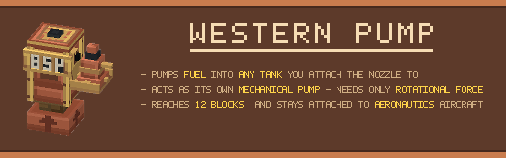

# Create: Western Pump



A Create addon for Minecraft 1.21.1 / NeoForge. A gas-station fuel pump with a physical, sagging
hose you drag over to a vehicle and leave attached while it fuels.

## Using it

Feed fuel into the **bottom half** of the pump from a Create fluid network, and give it
**rotational force** — it acts as its own Mechanical Pump, so no separate pump is needed.

Right-click the nozzle to lift it off the cradle, walk it over to any tank or fuel port, and
right-click that to hook it up. Fuel flows until the tank is full or you pull the nozzle free.
Right-click the cradle again to rack it. Goggles show the pump's status and what it is fuelling.

The brass selector under the counter sets the **flow direction**, the same hold-right-click
control as a Steam Engine's. Switch it to *Drain* and the pump runs backwards: fuel is drawn out
of the tank the nozzle is plugged into and pushed down into the pipes below. The arrows on the
base flip to show which way it is running.

## Configuration

In-game via **Mods → Create: Western Pump → Config**, or by editing
`config/westernpump-common.toml`:

| Setting | Default | What it does |
| --- | --- | --- |
| Hose Range | 12 | How far, in blocks, the nozzle can travel from the pump |
| Buffer Capacity | 2000 mB | Size of the pump's internal fuel buffer |
| Transfer Rate | 50 mB/t | Most fuel moved into the target per tick |
| Auto-Detach When Full | off | Retract the nozzle once the tank is full |

## Recommended alongside

- **[Create: Aeronautics](https://modrinth.com/mod/create-aeronautics)** the hose stays attached as they move!!
- **[Create: Diesel Generators](https://modrinth.com/mod/create-diesel-generators)** fuels and
  tanks to pump. The pump joins its creative tab when it is installed.

Neither is required but idk what you would be using this for then.

## Attribution

The hose's catenary solver in
[`HoseCurve`](src/main/java/me/jamino/westernpump/content/hose/HoseCurve.java) is adapted from
[Create: Power Grid](https://github.com/patryk3211/PowerGrid)'s `CurveParameters`
(Apache License 2.0, © 2025 patryk3211). Its power-line rendering is what the fuel hose's sag and
tube geometry are modelled on. Power Grid's electrical network is not used or depended on.

## Build

```bash
./gradlew build      # jar in build/libs/
./gradlew runClient  # dev client
```

Art is generated, not hand-drawn: `python tools/generate_art.py`, then `tools/generate_icon.py`
and `tools/generate_banner.py` (requires Pillow).

MIT licensed.
