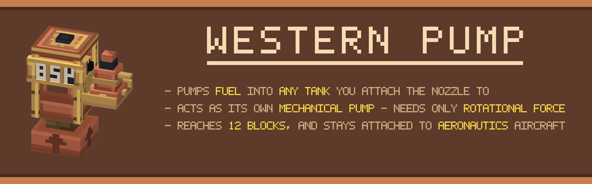

# Create: Western Pump



A Create addon for Minecraft 1.21.1 / NeoForge. A gas-station fuel pump with a physical, sagging
hose you drag over to a vehicle and leave attached while it fuels.

## Recommended alongside

- **[Create: Aeronautics](https://modrinth.com/mod/create-aeronautics)** the hose stays attached as they move!!
- **[Create: Diesel Generators](https://modrinth.com/mod/create-diesel-generators)** fuels and
  tanks to pump. The pump joins its creative tab when it is installed.

Neither is required but idk what you would be using this for then.

## Attribution

The hose's catenary solver in
[`HoseCurve`](src/main/java/me/jamino/westernpump/content/hose/HoseCurve.java) is adapted from
[Create: Power Grid](https://github.com/patryk3211/PowerGrid)'s `CurveParameters`
(Apache License 2.0, © 2025 patryk3211). Its power-line rendering is what the fuel hose's sag and
tube geometry are modelled on. Power Grid's electrical network is not used or depended on.

## Build

```bash
./gradlew build      # jar in build/libs/
./gradlew runClient  # dev client
```

Art is generated, not hand-drawn: `python tools/generate_art.py`, then `tools/generate_icon.py`
and `tools/generate_banner.py` (requires Pillow).

MIT licensed.
